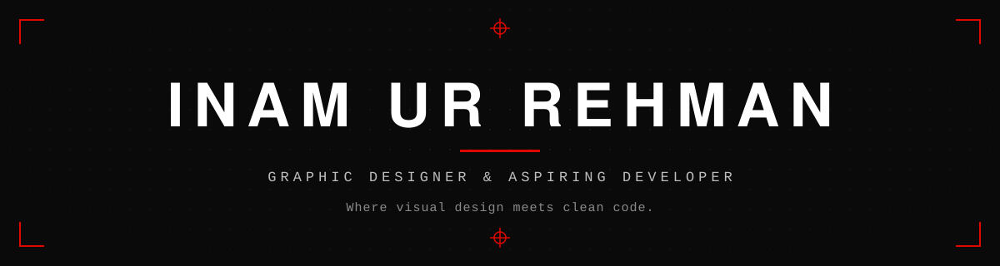
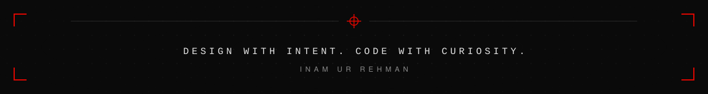

<!--
  Profile README — Inam Ur Rehman
  Concept: "Registration Marks & Code" — print-design crop marks meet a minimal developer aesthetic.
  Replace every YOUR_* placeholder before publishing. See the setup notes for the full checklist.
-->

 

<a href="#about">ABOUT</a> &nbsp;·&nbsp;
<a href="#technical-skills">SKILLS</a> &nbsp;·&nbsp;
<a href="#currently-exploring">EXPLORING</a> &nbsp;·&nbsp;
<a href="#featured-projects">PROJECTS</a> &nbsp;·&nbsp;
<a href="#github-statistics">STATS</a> &nbsp;·&nbsp;
<a href="#connect-with-me">CONNECT</a>

 

## About

I'm a graphic designer learning to build what I design.

My work starts with visual thinking: composition, hierarchy, restraint. I'm applying the same discipline to code, using **Python** for logic, **C++** for fundamentals, and **HTML & CSS** to turn ideas into real interfaces.

Design taught me to care about the details people feel without noticing. Programming is teaching me how things actually work underneath. I'm most interested in where the two meet: clean interfaces, well-structured software, and technology that feels considered.

<table>
  <tr>
    <td align="center"><b>Programming</b></td>
    <td align="center"><b>Web Development</b></td>
    <td align="center"><b>Software Engineering</b></td>
    <td align="center"><b>Creative Design</b></td>
    <td align="center"><b>Technology</b></td>
  </tr>
</table>

 

## Technical Skills

  
  
  
  

 

## Currently Exploring

> Suggested learning directions based on my interests — I'll update this list as my path becomes clearer.

- **Data structures & algorithms** — stronger problem-solving foundations in Python and C++
- **Git & collaborative workflows** — branching, pull requests, and a clean commit history
- **Responsive, accessible web design** — taking HTML and CSS toward production-quality interfaces
- **Software design principles** — structuring code so it stays readable as projects grow
- **Bridging design and code** — implementing visual ideas faithfully in the browser

 

## Featured Projects

> Placeholders — replace each entry with a real project.

<table>
  <tr>
    <td width="48" align="center"><h3>01</h3></td>
    <td>
      <b>[PROJECT_NAME]</b> 
      One concise sentence on what it does and why it matters. 
      <code>Python</code> &nbsp; <code>[TECH]</code>
    </td>
    <td align="right" width="130">
      <a href="https://github.com/fatalerror-404-app/YOUR_REPOSITORY">Repository →</a>
    </td>
  </tr>
  <tr>
    <td width="48" align="center"><h3>02</h3></td>
    <td>
      <b>[PROJECT_NAME]</b> 
      One concise sentence on what it does and why it matters. 
      <code>C++</code> &nbsp; <code>[TECH]</code>
    </td>
    <td align="right" width="130">
      <a href="https://github.com/fatalerror-404-app/YOUR_REPOSITORY">Repository →</a>
    </td>
  </tr>
  <tr>
    <td width="48" align="center"><h3>03</h3></td>
    <td>
      <b>[DESIGN_OR_WEB_PROJECT_NAME]</b> 
      One concise sentence on the problem, your design approach, and the result. 
      <code>HTML</code> &nbsp; <code>CSS</code>
    </td>
    <td align="right" width="130">
      <a href="https://YOUR_PROJECT_URL">Live preview →</a>
    </td>
  </tr>
</table>

 

## GitHub Statistics

  
  

  

 

## Connect With Me

  
  
  
  

<!-- Optional design-platform links — uncomment and edit if relevant:

-->

 

  

